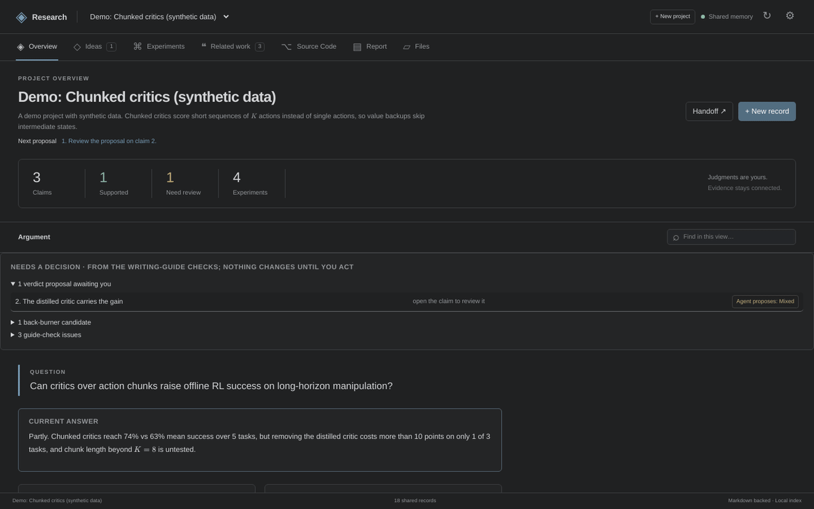
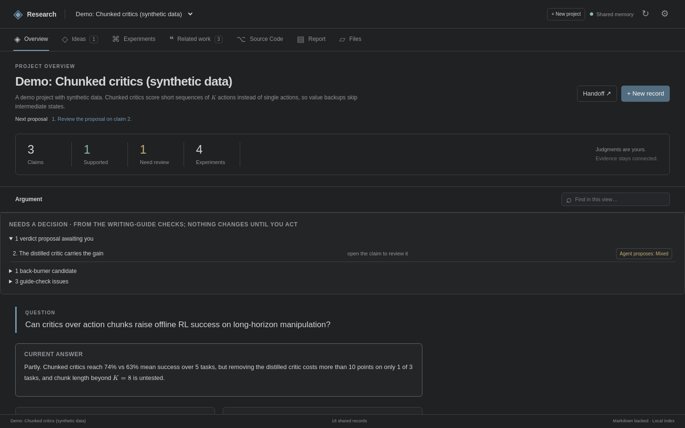
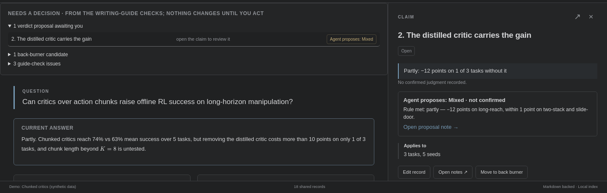
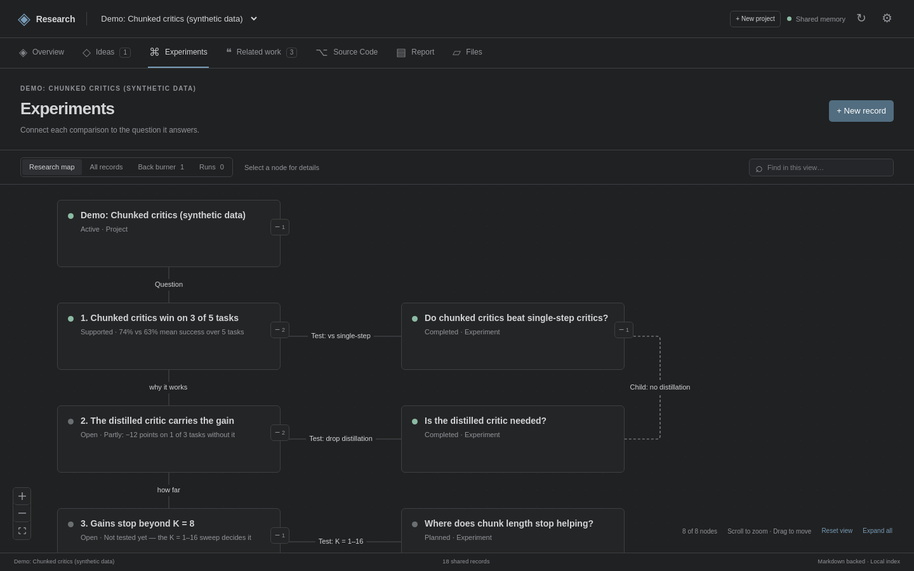
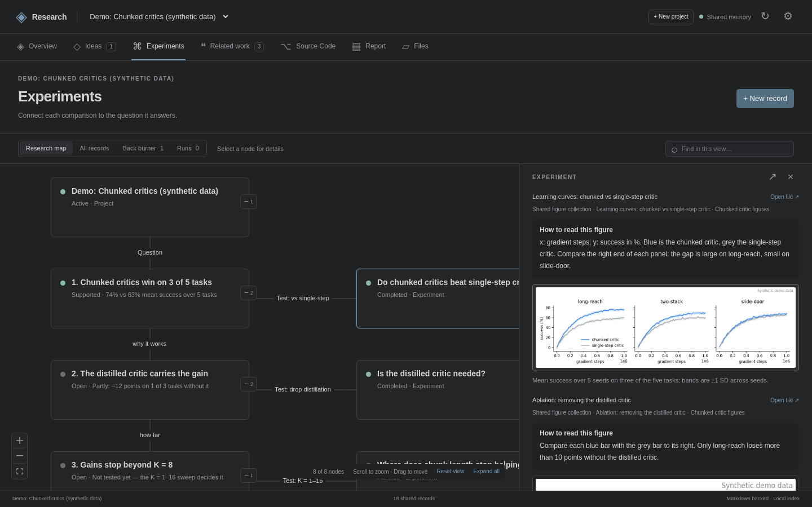
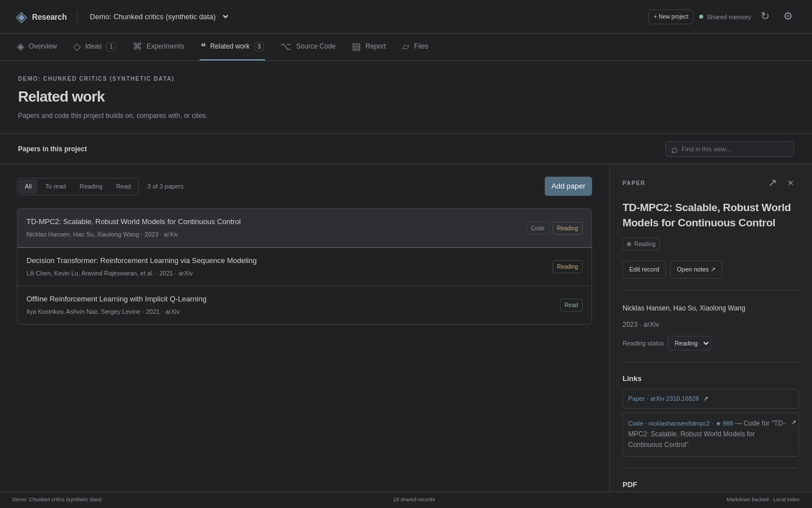
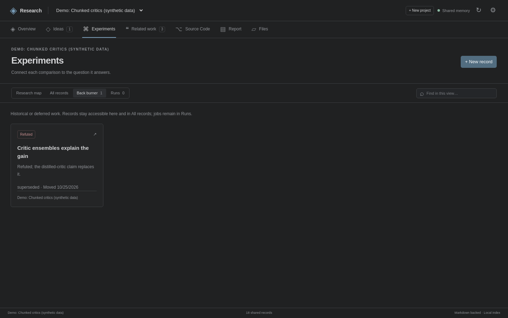

# Research Manager

**A shared research memory for you and your AI agents.** Claims, experiments, evidence and related work live as plain Markdown files. You see them as an argument map in VS Code; your agents read and write the same records through MCP, with far less context than reading the whole project.

[Product page](https://hanpushen.github.io/research-manager/) · [Download](https://github.com/HanpuShen/research-manager/releases) · [User guide](docs/user-guide.md) · [Guides for agents](docs/guides/)



<sub>All screenshots use the bundled [demo project](examples/demo-memory/) with synthetic data.</sub>

## What it does

<table>
<tr>
<td width="50%"></td>
<td><h3>See the argument, not the pile</h3>The Overview shows your question, the current answer and the chain of claims. <b>Needs a decision</b> lists what is waiting for you: agent verdict proposals, claims whose experiments are done, and work that can move to the back burner.</td>
</tr>
<tr>
<td></td>
<td><h3>Agents propose, you decide</h3>Every experiment has a decision rule written before it runs. When the result is in, an agent proposes Supported, Mixed or Refuted with the deciding numbers. Only you can change a claim's status.</td>
</tr>
<tr>
<td></td>
<td><h3>Every experiment tests one claim</h3>The experiment map places each comparison next to the claim it tests, with parent/child ablations and planned runs. Decided or outdated work moves to the back burner so the map stays short.</td>
</tr>
<tr>
<td></td>
<td><h3>Review a result in two minutes</h3>Open an experiment for its question, decision rule, <i>Rule met</i> verdict, measured table and figures, each with a guide on how to read it. Files stay where your runs wrote them.</td>
</tr>
<tr>
<td></td>
<td><h3>Related work with PDFs and code</h3>Give your agent a paper's name or arXiv link: it stores the metadata, BibTeX and PDF, and finds the authors' code from the abstract, project page, PDF and Hugging Face. Import a whole <code>.bib</code> at once.</td>
</tr>
<tr>
<td></td>
<td><h3>Prune without losing anything</h3>Refuted or superseded claims and experiments go to the back burner with a category and a reason. Evidence, history and links stay; restore any time.</td>
</tr>
</table>

Also included: a read-only Overleaf report workflow (outline, section reading, sync; you publish), reproducible Slurm runs with frozen source and inputs, a source-code map, and Google Drive file links.

## Quick start

1. **Install the app.** Download `research-manager-0.1.9.vsix` from [Releases](https://github.com/HanpuShen/research-manager/releases); in VS Code choose *Extensions → … → Install from VSIX* and run **Research Manager: Open**.
2. **Get the CLI, the MCP server and the demo.** Agents use the `research` command from a clone of this repository:

   ```bash
   git clone https://github.com/HanpuShen/research-manager.git && cd research-manager
   ./scripts/bootstrap.sh     # Linux: installs Node 24 into .tools/ and builds
   ```

   On macOS or Windows, install Node 24 yourself, then run `npm ci && npm run build`. To see the demo, run *Research Manager: Set Memory Folder* and choose `examples/demo-memory` in the clone; for your own work, choose an empty folder.
3. **Connect your agent** (Claude Code shown; any MCP client works, see [`examples/mcp.json`](examples/mcp.json)):

   ```bash
   claude mcp add research-manager -- "$PWD/bin/research" --memory /path/to/research-memory mcp
   ```

   Then ask: *"Read the handoff for my project and tell me what needs a decision."* Add `--read-only` after `mcp` for an agent that should analyse but not write.

## How it works

- **Markdown is the source of truth.** Each record is a file with YAML front matter in your memory folder; a local SQLite index makes it fast. Every change keeps the previous version in `history/`.
- **One memory, three doors.** The VS Code app, the `research` CLI and the MCP server share one implementation, revision checks and the same human-only rules.
- **Built for agent context budgets.** A project handoff is about 20 KB instead of megabytes; agents read one claim's evidence with `research_context`, search returns ranked cards, and `research_lint` checks the records against the writing guides.
- **Guides ship with the tool.** Writing guides for overviews, experiments, related work, the back burner and the report, plus the [ponytail](skills/readme.md) coding skill, are served to agents as MCP prompts.

## Documentation

| For | Read |
|---|---|
| Using the app and CLI | [User guide](docs/user-guide.md) |
| Agents working in a research memory | [Agent guide](docs/guides/agent-guide.md) · [Agent prompt](docs/guides/agent-prompt.md) · [all guides](docs/readme.md) |
| Agents developing this repository | [AGENTS.md](AGENTS.md) |

## Build from source

```bash
./scripts/bootstrap.sh            # Linux: Node 24 in .tools/, npm ci, build
export PATH="$PWD/.tools/bin:$PATH"
npm run check && npm test && npm run package
RESEARCH_MEMORY_ROOT=examples/demo-memory npm run preview   # the UI in a browser on port 4317
```

## License

[MIT](LICENSE). Bundled third-party components keep their licenses (ponytail: MIT; KaTeX fonts: MIT).
